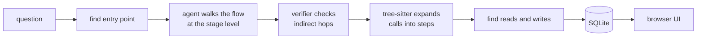

<h1 align="center">codemap</h1>

<p align="center">
  <b>Ask how a flow works in a codebase. Get a map you can zoom into, down to the code.</b>
</p>

<p align="center">
  <a href="https://github.com/capGoblin/codemap/actions/workflows/ci.yml"></a>
  <a href="LICENSE"></a>
  
  
</p>

https://github.com/user-attachments/assets/5ba84fca-c8b6-4546-ab5d-07b4e96d1289

*codemap tracing its own pipeline.*

```bash
codemap trace "what happens when a file is uploaded?"
```

Code written by AI is hard to read, and so is any codebase you did not write. codemap follows one flow end to end and draws it:

- **High-level stages first.** Open a stage to see its steps. Open a step to see its sub-steps, down to the code. Nothing opens on a new page.
- **Every node shows its side effects.** Database tables and fields, object stores, queues, caches, files and HTTP calls, each marked read or write.
- **Every node explains itself.** Click one to get how it works (each line cites the code), its input and output, the data it touches, and what it calls.
- **Real code paths only.** A separate verifier agent checks every indirect hop (queues, string dispatch, callbacks) before it goes on the map.
- **Any language.** Tree-sitter grammars are bundled.
- **Local.** Traces live in SQLite inside your repo. Only the model call leaves your machine.

## Quickstart

You need Python 3.12+, [uv](https://docs.astral.sh/uv/) and Node.js 20+ (to build the UI when you install from source).

```bash
# 1. install
uv tool install git+https://github.com/capGoblin/codemap

# 2. add a key (OpenAI by default)
export OPENAI_API_KEY=sk-...

# 3. trace a flow in any repo
cd path/to/your/repo
codemap trace "how does a request get authenticated?"
```

codemap lists candidate entry points, you pick one, and the graph opens in your browser a few minutes later. To try it without installing, use `uvx --from git+https://github.com/capGoblin/codemap codemap ...`.

A trace costs from a few cents to about 30 cents, depending on the model and the size of the flow.

## Commands

| Command | What it does |
| --- | --- |
| `codemap trace "<question>"` | Trace a flow and open it in the browser. Give `file.py:Symbol` to skip entry-point search. |
| `codemap trace "<question>" --lazy` | Build only the stage level. Deeper levels are built when you open a node. Faster and cheaper on big systems. |
| `codemap list` | List the traces saved in this repo. |
| `codemap open [ID]` | Open a saved trace in the browser. |
| `codemap doctor` | Check the key, the model, the price, ripgrep and the database. |

Options for `trace`: `--pick N` (skip the entry prompt), `--no-open`, `--json` (print the graph for scripts). Press Ctrl-C to stop a run and keep a partial trace.

## Models and keys

OpenAI and Anthropic are supported. Global options go before the command:

```bash
codemap --provider anthropic --model claude-sonnet-5-5 --max-cost 1.50 trace "..."
```

| Option | Env var | Default |
| --- | --- | --- |
| `--provider` | `CODEMAP_PROVIDER` | `openai` |
| `--model` | `CODEMAP_MODEL` | `gpt-5-nano` (OpenAI), `claude-haiku-5-5` (Anthropic) |
| `--api-key` | `CODEMAP_API_KEY`, `OPENAI_API_KEY`, `ANTHROPIC_API_KEY` | none |
| `--base-url` | `CODEMAP_BASE_URL` | the provider's API |
| `--max-cost` | `CODEMAP_MAX_COST` | `5.0` (USD per run) |

Defaults can also live in `~/.config/codemap/config.toml`. Flags beat env vars, which beat the config file.

- **Prefer the env var.** A key passed with `--api-key` stays in your shell history.
- **`--base-url`** points codemap at any OpenAI- or Anthropic-compatible endpoint, such as a proxy or a local server. For a model with no known price, set `price_in_per_mtok` and `price_out_per_mtok` in the config file so `--max-cost` works.
- **Pick a stronger model for hard flows.** The default is cheap, but small models give shallow traces on large, tangled systems.
- **Calls are cached.** An identical request costs nothing the second time.

## How it works



1. An agent starts at the entry point and walks the flow at the stage level, with read-only tools: list, read, ripgrep search, and tree-sitter find-definition and outline.
2. A separate verifier agent re-checks every indirect hop. It removes a hop only when it can point to the code that proves it wrong.
3. Tree-sitter resolves the calls inside each stage, and a model call turns them into steps.
4. Each node's reads and writes come from the code it covers, with real table and field names.
5. The "how it works" panel is written the first time you open a node, and every line cites the code.

The full walk-through is in [docs/guide](docs/guide/README.md).

## Privacy and safety

- Traces are stored in `<repo>/.codemap/codemap.db`. codemap adds `.codemap/` to `.git/info/exclude`. Source code and API keys are never stored.
- The agent has read-only tools and no shell. It cannot leave the repo.
- Files ignored by git, dependencies, build output, binaries and secrets (`.env*`, keys, `.npmrc`, `.netrc`, `credentials*`, `.aws/`, `.ssh/`, `*.tfvars`) are never read.
- The UI server listens on `127.0.0.1` only.
- The code snippets the agent reads are sent to your model provider. Use a provider you trust with that repo.

## Known limits

- A trace can be wrong, as any LLM output can. Every claim cites code, so check the citation.
- Small models give shallow traces on large flows. Use `--model` for those.
- Flows that cross services are traced as far as the repo goes.

## Development

```bash
git clone https://github.com/capGoblin/codemap && cd codemap
uv sync
npm --prefix frontend ci
make check    # ruff, mypy, import-linter, pytest, frontend typecheck and tests
make dev      # API on 127.0.0.1:8765 plus the Vite dev server
```

`make eval` traces codemap's own code and scores the result against `evals/codemap-trace.expected.json`. It uses your API key, costs a few cents, and repeat runs are free from the cache. See [CONTRIBUTING.md](CONTRIBUTING.md) for the rest.

## License

[MIT](LICENSE)
