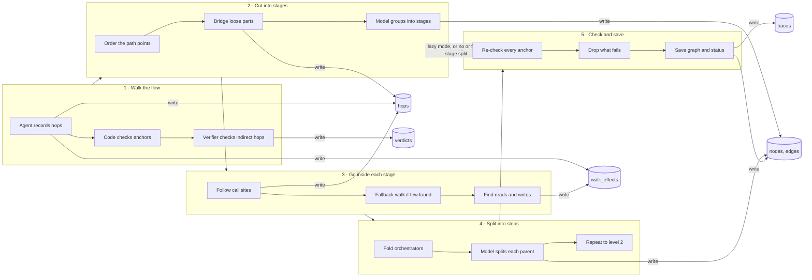

# How does the codemap pipeline work?

> **One question becomes a walked flow, a few stages with steps inside, and a graph whose every anchor is re-checked before it is saved.**
> `complete` · entry [`run.py:248-329`](https://github.com/capGoblin/codemap/blob/c30c50359c49b288d8ca08e3ed3657e782b31f8d/src/codemap/pipeline/run.py#L248-L329 "run_trace") · commit `c30c503` (dirty: 4 paths outside `src/`) · 2026-10-21

## Answer

- An agent walks the flow from the entry point with five tools that list, read and search the repo [`context.py:80-117`](https://github.com/capGoblin/codemap/blob/c30c50359c49b288d8ca08e3ed3657e782b31f8d/src/codemap/pipeline/context.py#L80-L117 "read_tools") [`walk.py:181-196`](https://github.com/capGoblin/codemap/blob/c30c50359c49b288d8ca08e3ed3657e782b31f8d/src/codemap/pipeline/walk.py#L181-L196 "_walk_tools") and records each hop through a tool that checks both anchors on disk. [`walk.py:121-155`](https://github.com/capGoblin/codemap/blob/c30c50359c49b288d8ca08e3ed3657e782b31f8d/src/codemap/pipeline/walk.py#L121-L155 "record_hop")
- A direct hop whose callee is named in the caller's code is accepted. Every other hop goes to a separate verifier agent. [`walk.py:142-155`](https://github.com/capGoblin/codemap/blob/c30c50359c49b288d8ca08e3ed3657e782b31f8d/src/codemap/pipeline/walk.py#L142-L155) That agent may reject a hop only with evidence and a valid anchor. [`verify.py:58-68`](https://github.com/capGoblin/codemap/blob/c30c50359c49b288d8ca08e3ed3657e782b31f8d/src/codemap/pipeline/verify.py#L58-L68 "_apply_rule")
- The model groups the recorded path points into stages. [`split.py:217-232`](https://github.com/capGoblin/codemap/blob/c30c50359c49b288d8ca08e3ed3657e782b31f8d/src/codemap/pipeline/split.py#L217-L232 "split_phases") Code, not the model, then expands each stage by following call sites. [`expand.py:85-139`](https://github.com/capGoblin/codemap/blob/c30c50359c49b288d8ca08e3ed3657e782b31f8d/src/codemap/pipeline/expand.py#L85-L139 "expand_static") Tree-sitter finds those call sites. [`calls.py:126-138`](https://github.com/capGoblin/codemap/blob/c30c50359c49b288d8ca08e3ed3657e782b31f8d/src/codemap/repo/calls.py#L126-L138 "calls_in") The model then splits stages into steps. [`split.py:402-412`](https://github.com/capGoblin/codemap/blob/c30c50359c49b288d8ca08e3ed3657e782b31f8d/src/codemap/pipeline/split.py#L402-L412)
- Validation drops every node whose anchors fail. [`validate.py:92-122`](https://github.com/capGoblin/codemap/blob/c30c50359c49b288d8ca08e3ed3657e782b31f8d/src/codemap/pipeline/validate.py#L92-L122 "validate_graph") The status is `partial` if more than 30% were dropped. [`validate.py:17`](https://github.com/capGoblin/codemap/blob/c30c50359c49b288d8ca08e3ed3657e782b31f8d/src/codemap/pipeline/validate.py#L17) [`run.py:317-322`](https://github.com/capGoblin/codemap/blob/c30c50359c49b288d8ca08e3ed3657e782b31f8d/src/codemap/pipeline/run.py#L317-L322)

## Trace card

| | |
| --- | --- |
| **Status** | `complete` — every stage cited, all 3 indirect hops confirmed by a separate subagent, nothing bridged |
| **Entry** | [`run.py:248-329`](https://github.com/capGoblin/codemap/blob/c30c50359c49b288d8ca08e3ed3657e782b31f8d/src/codemap/pipeline/run.py#L248-L329 "run_trace") — `Service` starts `_run` on a background thread [`service.py:125-131`](https://github.com/capGoblin/codemap/blob/c30c50359c49b288d8ca08e3ed3657e782b31f8d/src/codemap/service.py#L125-L131), and `_run` calls it [`service.py:139`](https://github.com/capGoblin/codemap/blob/c30c50359c49b288d8ca08e3ed3657e782b31f8d/src/codemap/service.py#L139) |
| **Commit** | `c30c503` (dirty: `.gitignore` and `README.md` changed, `skills/` and `docs/flows/` untracked; none under `src/`) |
| **Stages** | 5 stages, 15 steps |
| **Hops** | 40 recorded: 37 direct, 3 indirect (followed to the callee); ⚠️ 0 unsure, 0 bridged |
| **Doubts** | `record_effect` is registered like `record_hop` but was not checked on its own [`walk.py:190-195`](https://github.com/capGoblin/codemap/blob/c30c50359c49b288d8ca08e3ed3657e782b31f8d/src/codemap/pipeline/walk.py#L190-L195). The flow stops at the model provider call and at SQLite. |
| **Checked by** | `scripts/cite.py`, 3 verifier subagents for the indirect hops, and audit subagents (heavier than the skill's default) |

## Map

Solid line: a call. Dotted: the shortcut that lazy mode takes. Cylinder: SQLite table, with the arrow showing a write.

## Stages

### 1 · Walk the flow

> An agent follows the flow from the entry point and records each hop.

| | |
| --- | --- |
| **Starts at** | [`walk.py:238-241`](https://github.com/capGoblin/codemap/blob/c30c50359c49b288d8ca08e3ed3657e782b31f8d/src/codemap/pipeline/walk.py#L238-L241 "walk_skeleton") |
| **Takes in** | The entry anchor and the question |
| **Hands on** | Hops with a verdict, and side effects seen during the walk |
| **Boundary** | The agent submits [`loop.py:79-80`](https://github.com/capGoblin/codemap/blob/c30c50359c49b288d8ca08e3ed3657e782b31f8d/src/codemap/agents/loop.py#L79-L80). The hop limit (default 40, [`settings.py:44`](https://github.com/capGoblin/codemap/blob/c30c50359c49b288d8ca08e3ed3657e782b31f8d/src/codemap/settings.py#L44)) makes `record_hop` refuse further hops [`walk.py:122-124`](https://github.com/capGoblin/codemap/blob/c30c50359c49b288d8ca08e3ed3657e782b31f8d/src/codemap/pipeline/walk.py#L122-L124). A limit or model error ends the loop [`walk.py:229-232`](https://github.com/capGoblin/codemap/blob/c30c50359c49b288d8ca08e3ed3657e782b31f8d/src/codemap/pipeline/walk.py#L229-L232), and a cancel is seen before a model call [`limits.py:87-90`](https://github.com/capGoblin/codemap/blob/c30c50359c49b288d8ca08e3ed3657e782b31f8d/src/codemap/agents/limits.py#L87-L90 "check") |

**How it works**

1. `run_trace` starts the walk and keeps the reason if it stops early. [`run.py:252-255`](https://github.com/capGoblin/codemap/blob/c30c50359c49b288d8ca08e3ed3657e782b31f8d/src/codemap/pipeline/run.py#L252-L255)
2. The walk is a tool loop with the read tools plus `record_hop` and `record_effect`. [`walk.py:181-196`](https://github.com/capGoblin/codemap/blob/c30c50359c49b288d8ca08e3ed3657e782b31f8d/src/codemap/pipeline/walk.py#L181-L196 "_walk_tools")
3. Each turn checks the budget, calls the model, runs the tools it asked for, and ends when `submit` passes its schema. [`loop.py:53-82`](https://github.com/capGoblin/codemap/blob/c30c50359c49b288d8ca08e3ed3657e782b31f8d/src/codemap/agents/loop.py#L53-L82)
4. `record_hop` refuses a hop when either anchor fails the disk check. [`walk.py:126-127`](https://github.com/capGoblin/codemap/blob/c30c50359c49b288d8ca08e3ed3657e782b31f8d/src/codemap/pipeline/walk.py#L126-L127) In a deepen walk, which has a scope, it also refuses a hop whose caller lies outside the phase's anchors and outside the callees of hops already recorded in that pass. [`walk.py:110-115`](https://github.com/capGoblin/codemap/blob/c30c50359c49b288d8ca08e3ed3657e782b31f8d/src/codemap/pipeline/walk.py#L110-L115 "_in_scope") [`walk.py:128-129`](https://github.com/capGoblin/codemap/blob/c30c50359c49b288d8ca08e3ed3657e782b31f8d/src/codemap/pipeline/walk.py#L128-L129)
5. A direct hop is accepted when the callee's name is in the caller's code; it is stored as `code_checked`. [`walk.py:142-147`](https://github.com/capGoblin/codemap/blob/c30c50359c49b288d8ca08e3ed3657e782b31f8d/src/codemap/pipeline/walk.py#L142-L147)
6. Any other hop is typed indirect and sent to `verify_hop`, and the verdict is stored with it. [`walk.py:148-155`](https://github.com/capGoblin/codemap/blob/c30c50359c49b288d8ca08e3ed3657e782b31f8d/src/codemap/pipeline/walk.py#L148-L155)
7. The verifier is a fresh loop with the read tools and only the claim; a rejection needs evidence and a valid anchor, else it becomes `unsure`. [`verify.py:79-87`](https://github.com/capGoblin/codemap/blob/c30c50359c49b288d8ca08e3ed3657e782b31f8d/src/codemap/pipeline/verify.py#L79-L87) [`verify.py:58-68`](https://github.com/capGoblin/codemap/blob/c30c50359c49b288d8ca08e3ed3657e782b31f8d/src/codemap/pipeline/verify.py#L58-L68 "_apply_rule")

**Calls**

| From → to | Kind | Evidence |
| --- | --- | --- |
| `run_trace` → `walk_skeleton` | call | [`run.py:253`](https://github.com/capGoblin/codemap/blob/c30c50359c49b288d8ca08e3ed3657e782b31f8d/src/codemap/pipeline/run.py#L253) |
| `walk_skeleton` → `_run` | call | [`walk.py:241`](https://github.com/capGoblin/codemap/blob/c30c50359c49b288d8ca08e3ed3657e782b31f8d/src/codemap/pipeline/walk.py#L241) |
| `_run` → `run_tool_loop` | call | [`walk.py:217`](https://github.com/capGoblin/codemap/blob/c30c50359c49b288d8ca08e3ed3657e782b31f8d/src/codemap/pipeline/walk.py#L217) |
| `run_tool_loop` → `record_hop` | call | The loop builds a handler map by tool name and calls the match [`loop.py:40`](https://github.com/capGoblin/codemap/blob/c30c50359c49b288d8ca08e3ed3657e782b31f8d/src/codemap/agents/loop.py#L40) [`loop.py:114-118`](https://github.com/capGoblin/codemap/blob/c30c50359c49b288d8ca08e3ed3657e782b31f8d/src/codemap/agents/loop.py#L114-L118); the walk registers `record_hop` as a handler [`walk.py:184-189`](https://github.com/capGoblin/codemap/blob/c30c50359c49b288d8ca08e3ed3657e782b31f8d/src/codemap/pipeline/walk.py#L184-L189) |
| `run_tool_loop` → `CachedModel.respond` | call | The loop calls `model.respond` [`loop.py:56`](https://github.com/capGoblin/codemap/blob/c30c50359c49b288d8ca08e3ed3657e782b31f8d/src/codemap/agents/loop.py#L56); the context sets `model=CachedModel(...)` [`context.py:157-160`](https://github.com/capGoblin/codemap/blob/c30c50359c49b288d8ca08e3ed3657e782b31f8d/src/codemap/pipeline/context.py#L157-L160) |
| `CachedModel.respond` → `OpenAIModel.respond` or `AnthropicModel.respond` | call | On a cache miss it calls `self._inner.respond` [`recording.py:76-78`](https://github.com/capGoblin/codemap/blob/c30c50359c49b288d8ca08e3ed3657e782b31f8d/src/codemap/agents/recording.py#L76-L78); `make_model` picks the class from `settings.provider` [`providers.py:187-194`](https://github.com/capGoblin/codemap/blob/c30c50359c49b288d8ca08e3ed3657e782b31f8d/src/codemap/agents/providers.py#L187-L194 "make_model") |
| `record_hop` → `_first_error` | call | [`walk.py:126`](https://github.com/capGoblin/codemap/blob/c30c50359c49b288d8ca08e3ed3657e782b31f8d/src/codemap/pipeline/walk.py#L126) |
| `_first_error` → `check_anchor` | call | [`walk.py:104-108`](https://github.com/capGoblin/codemap/blob/c30c50359c49b288d8ca08e3ed3657e782b31f8d/src/codemap/pipeline/walk.py#L104-L108 "_first_error") |
| `record_hop` → `verify_hop` | call | [`walk.py:149`](https://github.com/capGoblin/codemap/blob/c30c50359c49b288d8ca08e3ed3657e782b31f8d/src/codemap/pipeline/walk.py#L149) |
| `verify_hop` → `run_tool_loop` | call | [`verify.py:80`](https://github.com/capGoblin/codemap/blob/c30c50359c49b288d8ca08e3ed3657e782b31f8d/src/codemap/pipeline/verify.py#L80) |
| `verify_hop` → `_apply_rule` | call | [`verify.py:90`](https://github.com/capGoblin/codemap/blob/c30c50359c49b288d8ca08e3ed3657e782b31f8d/src/codemap/pipeline/verify.py#L90) |

**Touches**

| Target | R/W | Fields | Where |
| --- | --- | --- | --- |
| `hops` | write | `trace_id`, `hop` (JSON) | [`traces.py:143-147`](https://github.com/capGoblin/codemap/blob/c30c50359c49b288d8ca08e3ed3657e782b31f8d/src/codemap/store/traces.py#L143-L147 "add_hop") |
| `verdicts` | write | `key`, `verdict`, `evidence`, `suggested` | [`caches.py:74-86`](https://github.com/capGoblin/codemap/blob/c30c50359c49b288d8ca08e3ed3657e782b31f8d/src/codemap/store/caches.py#L74-L86 "put") |
| `walk_effects` | write | `trace_id`, `effect` (JSON) | [`traces.py:166-171`](https://github.com/capGoblin/codemap/blob/c30c50359c49b288d8ca08e3ed3657e782b31f8d/src/codemap/store/traces.py#L166-L171 "add_walk_effect") |
| repo files | read | file text, 400-line pages | [`tools.py:78-98`](https://github.com/capGoblin/codemap/blob/c30c50359c49b288d8ca08e3ed3657e782b31f8d/src/codemap/repo/tools.py#L78-L98 "read_file") |

Steps inside (3)

1. **Agent records hops** — each one through the checked tool `record_hop`. [`walk.py:121-155`](https://github.com/capGoblin/codemap/blob/c30c50359c49b288d8ca08e3ed3657e782b31f8d/src/codemap/pipeline/walk.py#L121-L155 "record_hop") The prompt asks for one hop per stage, not into helpers [`walk_skeleton.md:47`](https://github.com/capGoblin/codemap/blob/c30c50359c49b288d8ca08e3ed3657e782b31f8d/src/codemap/prompts/walk_skeleton.md#L47), and tells it to step over plumbing. [`walk_skeleton.md:17-27`](https://github.com/capGoblin/codemap/blob/c30c50359c49b288d8ca08e3ed3657e782b31f8d/src/codemap/prompts/walk_skeleton.md#L17-L27)
2. **Code checks anchors** — file, range and symbol must exist. [`anchors.py:35-43`](https://github.com/capGoblin/codemap/blob/c30c50359c49b288d8ca08e3ed3657e782b31f8d/src/codemap/repo/anchors.py#L35-L43 "check_anchor")
3. **Verifier checks indirect hops** — a fresh agent that sees only the claim. [`verify.py:71-92`](https://github.com/capGoblin/codemap/blob/c30c50359c49b288d8ca08e3ed3657e782b31f8d/src/codemap/pipeline/verify.py#L71-L92 "verify_hop")

### 2 · Cut into stages

> Orders the recorded hops and asks the model to group them into stages.

| | |
| --- | --- |
| **Starts at** | [`run.py:257-281`](https://github.com/capGoblin/codemap/blob/c30c50359c49b288d8ca08e3ed3657e782b31f8d/src/codemap/pipeline/run.py#L257-L281) |
| **Takes in** | The hops from the walk |
| **Hands on** | One to seven top-level stages [`split.py:28`](https://github.com/capGoblin/codemap/blob/c30c50359c49b288d8ca08e3ed3657e782b31f8d/src/codemap/pipeline/split.py#L28) [`split.py:68`](https://github.com/capGoblin/codemap/blob/c30c50359c49b288d8ca08e3ed3657e782b31f8d/src/codemap/pipeline/split.py#L68), saved at once |
| **Boundary** | The stages are saved before the deepen block starts [`run.py:280-284`](https://github.com/capGoblin/codemap/blob/c30c50359c49b288d8ca08e3ed3657e782b31f8d/src/codemap/pipeline/run.py#L280-L284) |

**How it works**

1. A depth-first search from the entry orders the path points. [`rules.py:25-54`](https://github.com/capGoblin/codemap/blob/c30c50359c49b288d8ca08e3ed3657e782b31f8d/src/codemap/domain/rules.py#L25-L54 "ordered_points")
2. Hops the search did not reach are grouped. Each group whose root is not already on the path gets a bridge from the last point so far. [`rules.py:44-53`](https://github.com/capGoblin/codemap/blob/c30c50359c49b288d8ca08e3ed3657e782b31f8d/src/codemap/domain/rules.py#L44-L53)
3. Each bridge is stored as an `async` hop with verdict `unsure`, and a warning event is emitted. [`run.py:130-139`](https://github.com/capGoblin/codemap/blob/c30c50359c49b288d8ca08e3ed3657e782b31f8d/src/codemap/pipeline/run.py#L130-L139 "_bridge_hop") [`run.py:259-265`](https://github.com/capGoblin/codemap/blob/c30c50359c49b288d8ca08e3ed3657e782b31f8d/src/codemap/pipeline/run.py#L259-L265)
4. A tool-less model loop returns the stages. [`split.py:225-232`](https://github.com/capGoblin/codemap/blob/c30c50359c49b288d8ca08e3ed3657e782b31f8d/src/codemap/pipeline/split.py#L225-L232) When the schema rejects an answer, the error goes back to the model and the loop continues, up to 60 turns by default. [`loop.py:72-82`](https://github.com/capGoblin/codemap/blob/c30c50359c49b288d8ca08e3ed3657e782b31f8d/src/codemap/agents/loop.py#L72-L82) [`loop.py:34`](https://github.com/capGoblin/codemap/blob/c30c50359c49b288d8ca08e3ed3657e782b31f8d/src/codemap/agents/loop.py#L34) The schema needs 1 to 7 stages and spans that cover every point. [`split.py:59-81`](https://github.com/capGoblin/codemap/blob/c30c50359c49b288d8ca08e3ed3657e782b31f8d/src/codemap/pipeline/split.py#L59-L81 "PhasesSubmit") [`split.py:104-115`](https://github.com/capGoblin/codemap/blob/c30c50359c49b288d8ca08e3ed3657e782b31f8d/src/codemap/pipeline/split.py#L104-L115 "_phases_schema") Titles are at most 4 words, not counting a parenthesised code name, and may not be a bare function name. [`split.py:31-33`](https://github.com/capGoblin/codemap/blob/c30c50359c49b288d8ca08e3ed3657e782b31f8d/src/codemap/pipeline/split.py#L31-L33 "_words") [`split.py:26`](https://github.com/capGoblin/codemap/blob/c30c50359c49b288d8ca08e3ed3657e782b31f8d/src/codemap/pipeline/split.py#L26) [`split.py:36-38`](https://github.com/capGoblin/codemap/blob/c30c50359c49b288d8ca08e3ed3657e782b31f8d/src/codemap/pipeline/split.py#L36-L38) [`split.py:117-122`](https://github.com/capGoblin/codemap/blob/c30c50359c49b288d8ca08e3ed3657e782b31f8d/src/codemap/pipeline/split.py#L117-L122)
5. If that call fails and the walk recorded hops, each point becomes its own stage, so the walk is still shown. [`run.py:268-272`](https://github.com/capGoblin/codemap/blob/c30c50359c49b288d8ca08e3ed3657e782b31f8d/src/codemap/pipeline/run.py#L268-L272) [`run.py:110-127`](https://github.com/capGoblin/codemap/blob/c30c50359c49b288d8ca08e3ed3657e782b31f8d/src/codemap/pipeline/run.py#L110-L127 "_fallback_phases")
6. Every pair of consecutive stages gets an edge. It is `async` if a non-rejected `async` hop goes from the earlier stage into the next one, else `call`. Then the stages are saved. [`split.py:478-491`](https://github.com/capGoblin/codemap/blob/c30c50359c49b288d8ca08e3ed3657e782b31f8d/src/codemap/pipeline/split.py#L478-L491 "phase_edges") [`run.py:279-281`](https://github.com/capGoblin/codemap/blob/c30c50359c49b288d8ca08e3ed3657e782b31f8d/src/codemap/pipeline/run.py#L279-L281)

**Calls**

| From → to | Kind | Evidence |
| --- | --- | --- |
| `run_trace` → `ordered_points` | call | [`run.py:257`](https://github.com/capGoblin/codemap/blob/c30c50359c49b288d8ca08e3ed3657e782b31f8d/src/codemap/pipeline/run.py#L257) |
| `run_trace` → `_bridge_hop` | call | [`run.py:258`](https://github.com/capGoblin/codemap/blob/c30c50359c49b288d8ca08e3ed3657e782b31f8d/src/codemap/pipeline/run.py#L258) |
| `run_trace` → `split_phases` | call | [`run.py:268`](https://github.com/capGoblin/codemap/blob/c30c50359c49b288d8ca08e3ed3657e782b31f8d/src/codemap/pipeline/run.py#L268) |
| `split_phases` → `run_tool_loop` | call | [`split.py:225`](https://github.com/capGoblin/codemap/blob/c30c50359c49b288d8ca08e3ed3657e782b31f8d/src/codemap/pipeline/split.py#L225) |
| `run_trace` → `_fallback_phases` | branch | [`run.py:272`](https://github.com/capGoblin/codemap/blob/c30c50359c49b288d8ca08e3ed3657e782b31f8d/src/codemap/pipeline/run.py#L272) |
| `run_trace` → `phase_edges` | call | [`run.py:279`](https://github.com/capGoblin/codemap/blob/c30c50359c49b288d8ca08e3ed3657e782b31f8d/src/codemap/pipeline/run.py#L279) |

**Touches**

| Target | R/W | Fields | Where |
| --- | --- | --- | --- |
| `hops` | write | bridge hops | [`run.py:260`](https://github.com/capGoblin/codemap/blob/c30c50359c49b288d8ca08e3ed3657e782b31f8d/src/codemap/pipeline/run.py#L260) |
| `nodes`, `edges` | write | top-level stages | [`traces.py:202-205`](https://github.com/capGoblin/codemap/blob/c30c50359c49b288d8ca08e3ed3657e782b31f8d/src/codemap/store/traces.py#L202-L205 "save_nodes") |

Steps inside (3)

1. **Order the path points** — depth-first from the entry. [`rules.py:25-54`](https://github.com/capGoblin/codemap/blob/c30c50359c49b288d8ca08e3ed3657e782b31f8d/src/codemap/domain/rules.py#L25-L54 "ordered_points")
2. **Bridge loose parts** — a gap is shown, not hidden. [`run.py:130-139`](https://github.com/capGoblin/codemap/blob/c30c50359c49b288d8ca08e3ed3657e782b31f8d/src/codemap/pipeline/run.py#L130-L139 "_bridge_hop")
3. **Model groups into stages** — a schema rejects bad spans and titles. [`split.py:59-81`](https://github.com/capGoblin/codemap/blob/c30c50359c49b288d8ca08e3ed3657e782b31f8d/src/codemap/pipeline/split.py#L59-L81 "PhasesSubmit") [`split.py:104-122`](https://github.com/capGoblin/codemap/blob/c30c50359c49b288d8ca08e3ed3657e782b31f8d/src/codemap/pipeline/split.py#L104-L122)

### 3 · Go inside each stage

> Finds what each stage calls, and what it reads and writes.

| | |
| --- | --- |
| **Starts at** | [`run.py:175-211`](https://github.com/capGoblin/codemap/blob/c30c50359c49b288d8ca08e3ed3657e782b31f8d/src/codemap/pipeline/run.py#L175-L211 "_deepen_all") |
| **Takes in** | The stages and the skeleton hops |
| **Hands on** | Static `code_checked` hops [`expand.py:133`](https://github.com/capGoblin/codemap/blob/c30c50359c49b288d8ca08e3ed3657e782b31f8d/src/codemap/pipeline/expand.py#L133), any hops from the fallback walk, and side effects for each stage |
| **Boundary** | Eager mode only, with stages present and no stage-split failure; otherwise stages 3 and 4 are skipped [`run.py:282`](https://github.com/capGoblin/codemap/blob/c30c50359c49b288d8ca08e3ed3657e782b31f8d/src/codemap/pipeline/run.py#L282) |

**How it works**

1. For each stage, `expand_static` follows call sites from the stage's anchors, to depth 5 and 80 points by default. [`run.py:192-194`](https://github.com/capGoblin/codemap/blob/c30c50359c49b288d8ca08e3ed3657e782b31f8d/src/codemap/pipeline/run.py#L192-L194) [`settings.py:46-47`](https://github.com/capGoblin/codemap/blob/c30c50359c49b288d8ca08e3ed3657e782b31f8d/src/codemap/settings.py#L46-L47)
2. Tree-sitter finds the call sites inside the anchored lines, with a regex fallback when no grammar is available. [`calls.py:126-145`](https://github.com/capGoblin/codemap/blob/c30c50359c49b288d8ca08e3ed3657e782b31f8d/src/codemap/repo/calls.py#L126-L145 "calls_in")
3. Each call is resolved to one in-repo definition. A lone candidate is taken as is, unless the call is a dotted call to a common method name, which needs a definition in the same file or an imported file. With several candidates the order is same file, imported file, nearest directory. Ties are skipped. [`expand.py:58-82`](https://github.com/capGoblin/codemap/blob/c30c50359c49b288d8ca08e3ed3657e782b31f8d/src/codemap/pipeline/expand.py#L58-L82 "pick_definition")
4. The hops it records are direct calls with verdict `code_checked`, larger callees first. [`expand.py:85-139`](https://github.com/capGoblin/codemap/blob/c30c50359c49b288d8ca08e3ed3657e782b31f8d/src/codemap/pipeline/expand.py#L85-L139 "expand_static")
5. If fewer than 3 new points are found, the model-driven deepen walk runs as a fallback while the walk budget lasts. [`run.py:43`](https://github.com/capGoblin/codemap/blob/c30c50359c49b288d8ca08e3ed3657e782b31f8d/src/codemap/pipeline/run.py#L43) [`run.py:197-199`](https://github.com/capGoblin/codemap/blob/c30c50359c49b288d8ca08e3ed3657e782b31f8d/src/codemap/pipeline/run.py#L197-L199)
6. A tool-less model call per stage (at most 6 turns) lists reads and writes. Each cited line must lie inside the stage's code, and repeats are skipped. [`effects.py:84-91`](https://github.com/capGoblin/codemap/blob/c30c50359c49b288d8ca08e3ed3657e782b31f8d/src/codemap/pipeline/effects.py#L84-L91) [`effects.py:20`](https://github.com/capGoblin/codemap/blob/c30c50359c49b288d8ca08e3ed3657e782b31f8d/src/codemap/pipeline/effects.py#L20) [`effects.py:51-65`](https://github.com/capGoblin/codemap/blob/c30c50359c49b288d8ca08e3ed3657e782b31f8d/src/codemap/pipeline/effects.py#L51-L65 "_anchor_at") [`effects.py:72-117`](https://github.com/capGoblin/codemap/blob/c30c50359c49b288d8ca08e3ed3657e782b31f8d/src/codemap/pipeline/effects.py#L72-L117 "phase_effects")

**Calls**

| From → to | Kind | Evidence |
| --- | --- | --- |
| `run_trace` → `_deepen_all` | call | [`run.py:284`](https://github.com/capGoblin/codemap/blob/c30c50359c49b288d8ca08e3ed3657e782b31f8d/src/codemap/pipeline/run.py#L284) |
| `_deepen_all` → `expand_static` | call | [`run.py:192`](https://github.com/capGoblin/codemap/blob/c30c50359c49b288d8ca08e3ed3657e782b31f8d/src/codemap/pipeline/run.py#L192) |
| `expand_static` → `calls_in` | call | [`expand.py:85-139`](https://github.com/capGoblin/codemap/blob/c30c50359c49b288d8ca08e3ed3657e782b31f8d/src/codemap/pipeline/expand.py#L85-L139 "expand_static") |
| `expand_static` → `pick_definition` | call | [`expand.py:85-139`](https://github.com/capGoblin/codemap/blob/c30c50359c49b288d8ca08e3ed3657e782b31f8d/src/codemap/pipeline/expand.py#L85-L139 "expand_static") |
| `_deepen_all` → `walk_deepen` | branch | [`run.py:199`](https://github.com/capGoblin/codemap/blob/c30c50359c49b288d8ca08e3ed3657e782b31f8d/src/codemap/pipeline/run.py#L199) |
| `_deepen_all` → `phase_effects` | call | [`run.py:207`](https://github.com/capGoblin/codemap/blob/c30c50359c49b288d8ca08e3ed3657e782b31f8d/src/codemap/pipeline/run.py#L207) |
| `phase_effects` → `run_tool_loop` | call | [`effects.py:84`](https://github.com/capGoblin/codemap/blob/c30c50359c49b288d8ca08e3ed3657e782b31f8d/src/codemap/pipeline/effects.py#L84) |

**Touches**

| Target | R/W | Fields | Where |
| --- | --- | --- | --- |
| `hops` | write | static `code_checked` hops | [`expand.py:135`](https://github.com/capGoblin/codemap/blob/c30c50359c49b288d8ca08e3ed3657e782b31f8d/src/codemap/pipeline/expand.py#L135) [`walk.py:157-160`](https://github.com/capGoblin/codemap/blob/c30c50359c49b288d8ca08e3ed3657e782b31f8d/src/codemap/pipeline/walk.py#L157-L160 "store") |
| `walk_effects` | read | effects found so far | [`run.py:186`](https://github.com/capGoblin/codemap/blob/c30c50359c49b288d8ca08e3ed3657e782b31f8d/src/codemap/pipeline/run.py#L186) |
| `walk_effects` | write | `category`, `target`, `op`, `fields`, `anchor` | [`effects.py:72-117`](https://github.com/capGoblin/codemap/blob/c30c50359c49b288d8ca08e3ed3657e782b31f8d/src/codemap/pipeline/effects.py#L72-L117 "phase_effects") |

Steps inside (3)

1. **Follow call sites** — `expand_static` only parses files and records hops; it makes no model call. [`expand.py:99-136`](https://github.com/capGoblin/codemap/blob/c30c50359c49b288d8ca08e3ed3657e782b31f8d/src/codemap/pipeline/expand.py#L99-L136) [`calls.py:126-145`](https://github.com/capGoblin/codemap/blob/c30c50359c49b288d8ca08e3ed3657e782b31f8d/src/codemap/repo/calls.py#L126-L145 "calls_in")
2. **Fallback walk if few found** — unused hops carry over to the next stage. [`run.py:195-206`](https://github.com/capGoblin/codemap/blob/c30c50359c49b288d8ca08e3ed3657e782b31f8d/src/codemap/pipeline/run.py#L195-L206)
3. **Find reads and writes** — targets are normalised and repeats skipped. [`effects.py:72-117`](https://github.com/capGoblin/codemap/blob/c30c50359c49b288d8ca08e3ed3657e782b31f8d/src/codemap/pipeline/effects.py#L72-L117 "phase_effects")

### 4 · Split into steps

> Breaks each stage into steps, level by level, on worker threads.

| | |
| --- | --- |
| **Starts at** | [`run.py:295-299`](https://github.com/capGoblin/codemap/blob/c30c50359c49b288d8ca08e3ed3657e782b31f8d/src/codemap/pipeline/run.py#L295-L299) |
| **Takes in** | Stages, hops and effects |
| **Hands on** | Child nodes at levels 1 and 2 |
| **Boundary** | Inside the eager block, stages are split until a cancel arrives [`run.py:296-298`](https://github.com/capGoblin/codemap/blob/c30c50359c49b288d8ca08e3ed3657e782b31f8d/src/codemap/pipeline/run.py#L296-L298). A child is split further only if it is below level 2 and has 3 or more sub-path points [`run.py:41-43`](https://github.com/capGoblin/codemap/blob/c30c50359c49b288d8ca08e3ed3657e782b31f8d/src/codemap/pipeline/run.py#L41-L43) [`run.py:170-172`](https://github.com/capGoblin/codemap/blob/c30c50359c49b288d8ca08e3ed3657e782b31f8d/src/codemap/pipeline/run.py#L170-L172 "_eligible") [`run.py:299`](https://github.com/capGoblin/codemap/blob/c30c50359c49b288d8ca08e3ed3657e782b31f8d/src/codemap/pipeline/run.py#L299). Deeper levels are built by `expand_node` when a node is opened. [`run.py:332-340`](https://github.com/capGoblin/codemap/blob/c30c50359c49b288d8ca08e3ed3657e782b31f8d/src/codemap/pipeline/run.py#L332-L340 "expand_node") |

**How it works**

1. The loop splits the current parents, then makes the new children that qualify the next parents, until none are left or a cancel arrives. [`run.py:295-299`](https://github.com/capGoblin/codemap/blob/c30c50359c49b288d8ca08e3ed3657e782b31f8d/src/codemap/pipeline/run.py#L295-L299)
2. Eligibility is the level limit plus the count of sub-path points. [`run.py:170-172`](https://github.com/capGoblin/codemap/blob/c30c50359c49b288d8ca08e3ed3657e782b31f8d/src/codemap/pipeline/run.py#L170-L172 "_eligible")
3. `_split_level` builds one job per parent, using the parent's sub-path points, or the parent's own anchors when there are none. [`run.py:224-227`](https://github.com/capGoblin/codemap/blob/c30c50359c49b288d8ca08e3ed3657e782b31f8d/src/codemap/pipeline/run.py#L224-L227)
4. `_split_jobs` runs the jobs on daemon threads (up to 4 by default) and reports each result on the calling thread. [`run.py:62-107`](https://github.com/capGoblin/codemap/blob/c30c50359c49b288d8ca08e3ed3657e782b31f8d/src/codemap/pipeline/run.py#L62-L107 "_split_jobs") [`settings.py:50`](https://github.com/capGoblin/codemap/blob/c30c50359c49b288d8ca08e3ed3657e782b31f8d/src/codemap/settings.py#L50)
5. `split_children` first removes orchestrators from the points the model sees [`split.py:387`](https://github.com/capGoblin/codemap/blob/c30c50359c49b288d8ca08e3ed3657e782b31f8d/src/codemap/pipeline/split.py#L387): functions with at least 3 call sites to other points and at least 3 distinct callees among them, no effects, and a line count of at most 25% of their callees' lines combined. [`orchestrators.py:14-15`](https://github.com/capGoblin/codemap/blob/c30c50359c49b288d8ca08e3ed3657e782b31f8d/src/codemap/pipeline/orchestrators.py#L14-L15) [`orchestrators.py:32-54`](https://github.com/capGoblin/codemap/blob/c30c50359c49b288d8ca08e3ed3657e782b31f8d/src/codemap/pipeline/orchestrators.py#L32-L54 "find_orchestrators")
6. It then makes one tool-less model call (at most 6 turns). [`split.py:264`](https://github.com/capGoblin/codemap/blob/c30c50359c49b288d8ca08e3ed3657e782b31f8d/src/codemap/pipeline/split.py#L264) It keeps only the anchors that lie inside the parent or a sub-path point, and drops a step that has none left. [`split.py:402-412`](https://github.com/capGoblin/codemap/blob/c30c50359c49b288d8ca08e3ed3657e782b31f8d/src/codemap/pipeline/split.py#L402-L412) [`split.py:415-423`](https://github.com/capGoblin/codemap/blob/c30c50359c49b288d8ca08e3ed3657e782b31f8d/src/codemap/pipeline/split.py#L415-L423)
7. Children are saved as they arrive. A split that returns a failure reason puts a note on the parent instead of stopping the run. [`run.py:229-245`](https://github.com/capGoblin/codemap/blob/c30c50359c49b288d8ca08e3ed3657e782b31f8d/src/codemap/pipeline/run.py#L229-L245)

**Calls**

| From → to | Kind | Evidence |
| --- | --- | --- |
| `run_trace` → `_split_level` | call | [`run.py:298`](https://github.com/capGoblin/codemap/blob/c30c50359c49b288d8ca08e3ed3657e782b31f8d/src/codemap/pipeline/run.py#L298) |
| `_split_level` → `_split_jobs` | call | [`run.py:244`](https://github.com/capGoblin/codemap/blob/c30c50359c49b288d8ca08e3ed3657e782b31f8d/src/codemap/pipeline/run.py#L244) |
| `_split_jobs` → `split_children` | async | [`run.py:85`](https://github.com/capGoblin/codemap/blob/c30c50359c49b288d8ca08e3ed3657e782b31f8d/src/codemap/pipeline/run.py#L85) |
| `split_children` → `flatten_points` | call | [`split.py:387`](https://github.com/capGoblin/codemap/blob/c30c50359c49b288d8ca08e3ed3657e782b31f8d/src/codemap/pipeline/split.py#L387) |
| `flatten_points` → `find_orchestrators` | call | [`orchestrators.py:61`](https://github.com/capGoblin/codemap/blob/c30c50359c49b288d8ca08e3ed3657e782b31f8d/src/codemap/pipeline/orchestrators.py#L61) |
| `find_orchestrators` → `calls_in` | call | [`orchestrators.py:44`](https://github.com/capGoblin/codemap/blob/c30c50359c49b288d8ca08e3ed3657e782b31f8d/src/codemap/pipeline/orchestrators.py#L44) |
| `split_children` → `run_tool_loop` | call | [`split.py:403`](https://github.com/capGoblin/codemap/blob/c30c50359c49b288d8ca08e3ed3657e782b31f8d/src/codemap/pipeline/split.py#L403) |
| `_split_level` → `steps_edges` | call | [`run.py:236`](https://github.com/capGoblin/codemap/blob/c30c50359c49b288d8ca08e3ed3657e782b31f8d/src/codemap/pipeline/run.py#L236) |

**Touches**

| Target | R/W | Fields | Where |
| --- | --- | --- | --- |
| `nodes`, `edges` | write | child nodes and their order edges | [`traces.py:202-205`](https://github.com/capGoblin/codemap/blob/c30c50359c49b288d8ca08e3ed3657e782b31f8d/src/codemap/store/traces.py#L202-L205 "save_nodes") |

Steps inside (3)

1. **Fold orchestrators** — they are removed from the points the model sees. [`orchestrators.py:57-63`](https://github.com/capGoblin/codemap/blob/c30c50359c49b288d8ca08e3ed3657e782b31f8d/src/codemap/pipeline/orchestrators.py#L57-L63 "flatten_points")
2. **Model splits each parent** — a schema rejects titles that are only a function name. [`split.py:179-192`](https://github.com/capGoblin/codemap/blob/c30c50359c49b288d8ca08e3ed3657e782b31f8d/src/codemap/pipeline/split.py#L179-L192 "_children_schema")
3. **Repeat to level 2** — only for children that qualify. [`run.py:295-299`](https://github.com/capGoblin/codemap/blob/c30c50359c49b288d8ca08e3ed3657e782b31f8d/src/codemap/pipeline/run.py#L295-L299)

### 5 · Check and save

> Re-checks every anchor, drops what fails, and saves the graph.

| | |
| --- | --- |
| **Starts at** | [`run.py:301-329`](https://github.com/capGoblin/codemap/blob/c30c50359c49b288d8ca08e3ed3657e782b31f8d/src/codemap/pipeline/run.py#L301-L329) |
| **Takes in** | All nodes, edges and the on-path points |
| **Hands on** | The saved graph, the totals and the final status |
| **Boundary** | Last step of the build; it ends by emitting the `finished` event [`run.py:328`](https://github.com/capGoblin/codemap/blob/c30c50359c49b288d8ca08e3ed3657e782b31f8d/src/codemap/pipeline/run.py#L328) |

**How it works**

1. Error and branch hops that were not rejected become side nodes, at most one per hop (none if no node holds the caller). They are exempt from the on-path check below. [`rules.py:94-95`](https://github.com/capGoblin/codemap/blob/c30c50359c49b288d8ca08e3ed3657e782b31f8d/src/codemap/domain/rules.py#L94-L95 "side_hops") [`split.py:500-525`](https://github.com/capGoblin/codemap/blob/c30c50359c49b288d8ca08e3ed3657e782b31f8d/src/codemap/pipeline/split.py#L500-L525 "side_nodes") [`validate.py:63`](https://github.com/capGoblin/codemap/blob/c30c50359c49b288d8ca08e3ed3657e782b31f8d/src/codemap/pipeline/validate.py#L63) The walk prompt asks for such paths to be one hop deep; the code does not enforce it. [`walk_skeleton.md:46`](https://github.com/capGoblin/codemap/blob/c30c50359c49b288d8ca08e3ed3657e782b31f8d/src/codemap/prompts/walk_skeleton.md#L46)
2. Validation keeps only anchors and effects that pass the disk check. A step inside its parent's anchors is checked for range only. [`validate.py:37-54`](https://github.com/capGoblin/codemap/blob/c30c50359c49b288d8ca08e3ed3657e782b31f8d/src/codemap/pipeline/validate.py#L37-L54 "_grounded")
3. A node with no valid anchor, or off the recorded path, is dropped with a reason. A dropped node takes its subtree with it. [`validate.py:57-65`](https://github.com/capGoblin/codemap/blob/c30c50359c49b288d8ca08e3ed3657e782b31f8d/src/codemap/pipeline/validate.py#L57-L65 "_drop_reason") [`validate.py:105-117`](https://github.com/capGoblin/codemap/blob/c30c50359c49b288d8ca08e3ed3657e782b31f8d/src/codemap/pipeline/validate.py#L105-L117)
4. Effects roll up from the leaves: a node's effects are its children's plus its own uncovered ones. [`validate.py:73-89`](https://github.com/capGoblin/codemap/blob/c30c50359c49b288d8ca08e3ed3657e782b31f8d/src/codemap/pipeline/validate.py#L73-L89 "_rollup")
5. `replace_graph` swaps the draft for the final graph in one transaction, then the token and cost totals are stored. [`run.py:313-315`](https://github.com/capGoblin/codemap/blob/c30c50359c49b288d8ca08e3ed3657e782b31f8d/src/codemap/pipeline/run.py#L313-L315) [`traces.py:207-212`](https://github.com/capGoblin/codemap/blob/c30c50359c49b288d8ca08e3ed3657e782b31f8d/src/codemap/store/traces.py#L207-L212 "replace_graph")
6. Status is `failed` if no stage survived, and `partial` if there are reasons or more than 30% of nodes were dropped. A cancel is always `partial`. [`run.py:142-145`](https://github.com/capGoblin/codemap/blob/c30c50359c49b288d8ca08e3ed3657e782b31f8d/src/codemap/pipeline/run.py#L142-L145 "_status") [`validate.py:17`](https://github.com/capGoblin/codemap/blob/c30c50359c49b288d8ca08e3ed3657e782b31f8d/src/codemap/pipeline/validate.py#L17) [`run.py:322-326`](https://github.com/capGoblin/codemap/blob/c30c50359c49b288d8ca08e3ed3657e782b31f8d/src/codemap/pipeline/run.py#L322-L326)

**Calls**

| From → to | Kind | Evidence |
| --- | --- | --- |
| `run_trace` → `side_nodes` | call | [`run.py:301`](https://github.com/capGoblin/codemap/blob/c30c50359c49b288d8ca08e3ed3657e782b31f8d/src/codemap/pipeline/run.py#L301) |
| `run_trace` → `validate_graph` | call | [`run.py:303`](https://github.com/capGoblin/codemap/blob/c30c50359c49b288d8ca08e3ed3657e782b31f8d/src/codemap/pipeline/run.py#L303) |
| `validate_graph` → `_grounded` | call | [`validate.py:105`](https://github.com/capGoblin/codemap/blob/c30c50359c49b288d8ca08e3ed3657e782b31f8d/src/codemap/pipeline/validate.py#L105) |
| `_grounded` → `check_anchor` | call | [`validate.py:48`](https://github.com/capGoblin/codemap/blob/c30c50359c49b288d8ca08e3ed3657e782b31f8d/src/codemap/pipeline/validate.py#L48) |
| `run_trace` → `replace_graph` | call | [`run.py:314`](https://github.com/capGoblin/codemap/blob/c30c50359c49b288d8ca08e3ed3657e782b31f8d/src/codemap/pipeline/run.py#L314) |
| `run_trace` → `set_totals` | call | [`run.py:315`](https://github.com/capGoblin/codemap/blob/c30c50359c49b288d8ca08e3ed3657e782b31f8d/src/codemap/pipeline/run.py#L315) |
| `run_trace` → `_status` | call | [`run.py:322`](https://github.com/capGoblin/codemap/blob/c30c50359c49b288d8ca08e3ed3657e782b31f8d/src/codemap/pipeline/run.py#L322) |
| `run_trace` → `set_status` | call | [`run.py:327`](https://github.com/capGoblin/codemap/blob/c30c50359c49b288d8ca08e3ed3657e782b31f8d/src/codemap/pipeline/run.py#L327) |

**Touches**

| Target | R/W | Fields | Where |
| --- | --- | --- | --- |
| `nodes`, `edges` | write | the whole graph | [`traces.py:207-212`](https://github.com/capGoblin/codemap/blob/c30c50359c49b288d8ca08e3ed3657e782b31f8d/src/codemap/store/traces.py#L207-L212 "replace_graph") |
| `traces` | write | `status` | [`traces.py:109-111`](https://github.com/capGoblin/codemap/blob/c30c50359c49b288d8ca08e3ed3657e782b31f8d/src/codemap/store/traces.py#L109-L111 "set_status") |
| `traces` | write | `input_tokens`, `output_tokens`, `cost_usd` | [`traces.py:114-121`](https://github.com/capGoblin/codemap/blob/c30c50359c49b288d8ca08e3ed3657e782b31f8d/src/codemap/store/traces.py#L114-L121 "set_totals") |

Steps inside (3)

1. **Re-check every anchor** — a range check for sub-range steps, a symbol check otherwise. [`validate.py:37-54`](https://github.com/capGoblin/codemap/blob/c30c50359c49b288d8ca08e3ed3657e782b31f8d/src/codemap/pipeline/validate.py#L37-L54 "_grounded")
2. **Drop what fails** — each drop carries a reason. [`validate.py:57-65`](https://github.com/capGoblin/codemap/blob/c30c50359c49b288d8ca08e3ed3657e782b31f8d/src/codemap/pipeline/validate.py#L57-L65 "_drop_reason")
3. **Save graph and status** — the graph in one transaction, then the totals, the status and the `finished` event, each as its own write. [`traces.py:207-212`](https://github.com/capGoblin/codemap/blob/c30c50359c49b288d8ca08e3ed3657e782b31f8d/src/codemap/store/traces.py#L207-L212 "replace_graph") [`run.py:313-328`](https://github.com/capGoblin/codemap/blob/c30c50359c49b288d8ca08e3ed3657e782b31f8d/src/codemap/pipeline/run.py#L313-L328)

