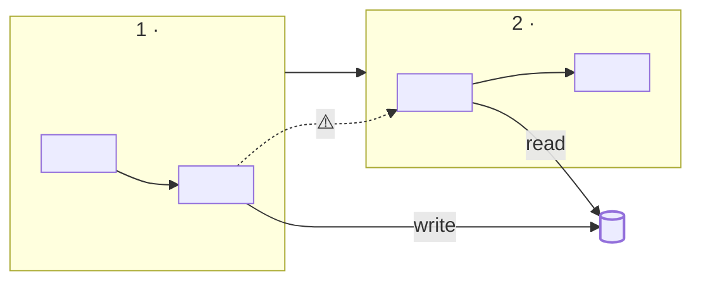

# The trace file

Write `docs/flows/<slug>.md` with exactly these four sections, in this order: Answer, Trace card, Map, Stages. The script checks the names. Replace everything in `<angle brackets>`.

## Style rules

- **Scannable first.** A reader gets the answer and the map in 30 seconds. Detail is folded in `<details>`.
- **One citation style.** `[`file.ts:40-88`](url "symbol")`. Show the file name and lines. The URL is a GitHub permalink (`https://github.com/<owner>/<repo>/blob/<full-sha>/<path>#L40-L88`) when the remote is GitHub, else a relative path from the trace file (`../../src/auth/verify.ts#L40-L88`). Put the symbol in the link title only when the range contains that function's definition line. A range inside a function gets no title. A wrong title fails the check.
- **One badge: ⚠️ unsure.** Put it on a hop nobody could prove or disprove, in the Evidence cell and in the Map. A hop with no badge is one you proved. Say "bridged" in the Evidence cell when no code link joins two stages.
- **Words.** Stage titles: at most 4 words, never a bare function name. Summaries: one sentence, at most 14 words. Short sentences, active voice.
- **Say no more than the lines show.** If a number or a condition is not in the cited lines, cite it or leave it out.
- **No decoration.** No other emoji, no images, no HTML except `<details>`, `<summary>` and `<br>`.

## Skeleton

````markdown
# <The user's question, as a title>

> **<One line: what the flow does, from trigger to end.>**
> `<status>` · entry [`<file>:<lines>`](<url> "<symbol>") · commit `<short-sha>` · <YYYY-MM-DD>

## Answer

- <Claim 1. At most 25 words.> [`<file>:<lines>`](<url>)
- <Claim 2. At most four bullets.> [`<file>:<lines>`](<url>)

## Trace card

| | |
| --- | --- |
| **Status** | `complete` / `partial` / `failed` — <reason if not complete> |
| **Entry** | [`<file>:<lines>`](<url> "<symbol>") — <route, command or trigger> |
| **Commit** | `<short-sha>` (<clean / dirty: what changed>) |
| **Stages** | <n> stages, <n> steps |
| **Hops** | <n> recorded: <n> direct, <n> indirect; ⚠️ <n> unsure, <n> bridged |
| **Doubts** | <the top one to three doubts, or "None found"> |
| **Checked by** | `scripts/cite.py` + <you / verifier subagents> |

## Map



<sub>Solid line: a call. Dashed: an indirect hop. Dotted: ⚠️ unsure or bridged. Cylinder: data store, with the arrow showing read or write.</sub>

## Stages

### 1 · <Stage title>

> <Summary, at most 14 words.>

| | |
| --- | --- |
| **Starts at** | [`<file>:<lines>`](<url> "<symbol>") |
| **Boundary** | <why the stage starts and ends here> |

**How it works**

1. <Step, one sentence.> [`<file>:<lines>`](<url>)
2. <3 to 5 steps. Every line cites.> [`<file>:<lines>`](<url>)

**Calls**

| From → to | Kind | Evidence |
| --- | --- | --- |
| `<caller>` → `<callee>` | call | [`<file>:<lines>`](<url>) |
| `<caller>` → `<callee>` | async | <how the wiring reaches the callee> [`<file>:<lines>`](<url>) |
| `<caller>` → `<callee>` | call | ⚠️ unsure: <what is missing> |

**Touches**

| Target | R/W | Fields | Where |
| --- | --- | --- | --- |
| `<table>` | write | `<col>`, `<col>` | [`<file>:<lines>`](<url>) |

<details>
<summary>Steps inside (<n>)</summary>

1. **<Step title>** — <one sentence.> [`<file>:<lines>`](<url> "<symbol>")

</details>

### 2 · <Stage title>

<same fields as stage 1>
````

## Filling it well

- **Answer** is written last, from the finished stages.
- **Map** has 3 to 7 subgraphs and about 25 nodes at most. Node text is a step title, not a function name. If the diagram is crowded, drop steps, not stages. Escape quotes in labels.
- **Calls** lists only hops that start inside the stage. Leave out a table that would be empty.
- **Doubts** are the only place for open questions. Do not hide an unsure hop. Mark it ⚠️ in the stage and name it here.
